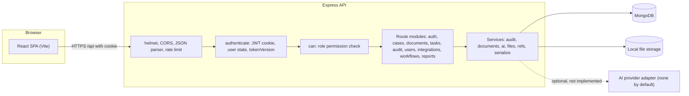
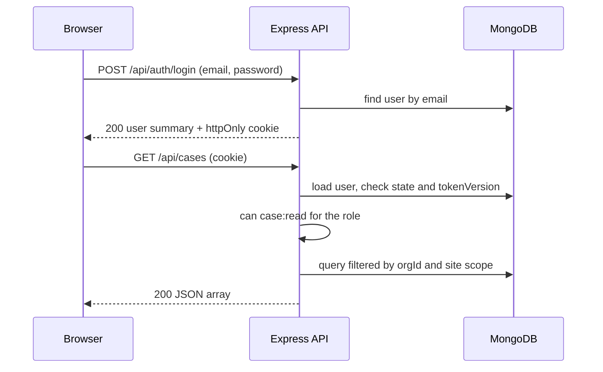
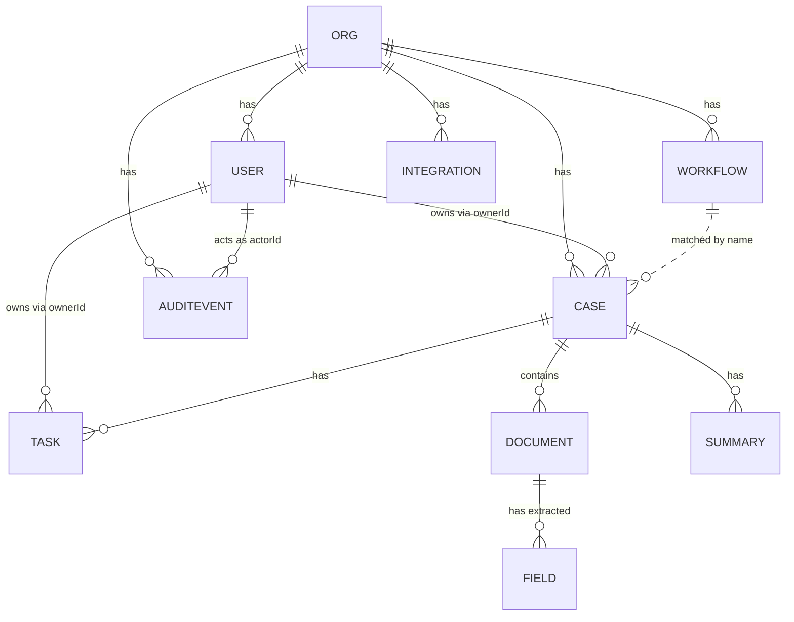
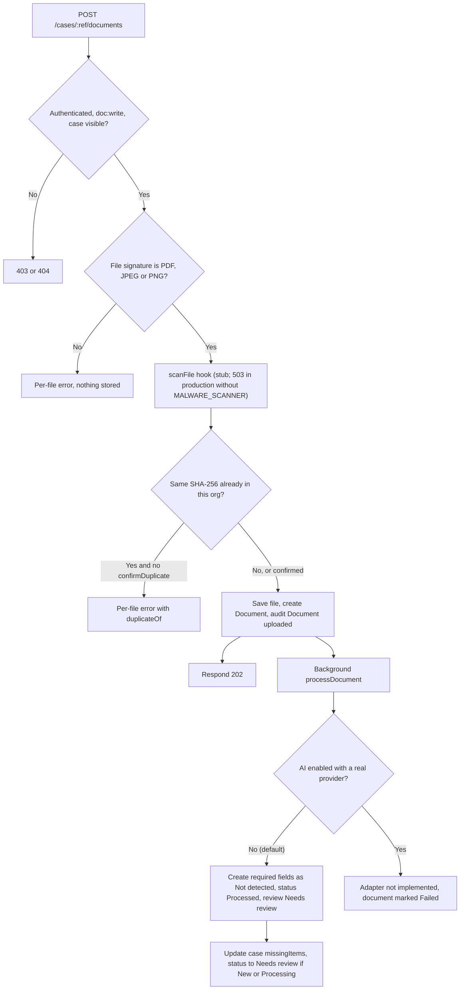

# CareOps AI

> A secure, auditable workflow platform for healthcare **administrative operations**: case intake, document review with source evidence, task routing, and operational reporting. A MERN-stack (MongoDB, Express, React, Node.js) prototype built from the CareOps AI PRD and UI/UX specification.

  

> [!WARNING]
> **This is not production software and it must not process real patient data.** It is an administrative and operational support tool, **not** a diagnostic or treatment system. Several PRD P0 requirements (MFA/SSO, malware scanning, OCR/LLM extraction, automated tests, independent security review) are **not yet implemented**. See [Limitations](#20-limitations-roadmap-and-future-improvements).

---

## At a glance

| | |
|---|---|
| **What it is** | A web app (React SPA + Express/MongoDB API) for healthcare operations teams to manage cases, documents, tasks and audit evidence. |
| **Who it is for** | Operations administrators, team leads, compliance officers, IT administrators, executives/analysts, and authorised clinical reviewers at healthcare providers (initial target market per the PRD: Abu Dhabi, then UAE/GCC). |
| **Core idea** | AI *proposes*, people *review and approve*. Every AI-style suggestion carries its source evidence or is marked **unverified**, and every action is recorded in a tamper-evident audit log. |
| **Current state** | Frontend runs fully on built-in synthetic data. Backend implements auth, RBAC, cases, documents, tasks, audit, users, integrations (read/pause) and workflows (read). No OCR/LLM provider is wired in. |
| **Repository layout** | Two apps: [`careops-frontend/`](./careops-frontend) and [`careops-backend/`](./careops-backend). |

## Table of contents

1. [Introduction](#1-introduction)
2. [Features](#2-main-features-and-capabilities)
3. [Technology stack](#3-technology-stack)
4. [Architecture](#4-architecture-and-system-design)
5. [Folder structure](#5-project-folder-structure)
6. [Prerequisites and installation](#6-prerequisites-and-installation)
7. [Environment variables](#7-environment-variables-and-configuration)
8. [Usage and workflows](#8-application-usage-and-workflows)
9. [Roles and permissions](#9-user-roles-and-permissions)
10. [API reference](#10-api-documentation)
11. [Database design](#11-database-design-and-data-models)
12. [Business logic](#12-business-logic-and-core-workflows)
13. [Development commands](#13-development-commands-and-scripts)
14. [Testing](#14-testing-and-quality-assurance)
15. [Security and privacy](#15-security-and-privacy)
16. [Integrations](#16-integrations-and-external-services)
17. [Deployment](#17-deployment-and-production-setup)
18. [Troubleshooting and FAQ](#18-troubleshooting-and-frequently-asked-questions)
19. [Contributing](#19-contribution-guidelines)
20. [Limitations and roadmap](#20-limitations-roadmap-and-future-improvements)
21. [License, credits, contact](#21-licensing-credits-and-contact)

---

## 1. Introduction

### The problem
Healthcare administrative teams often coordinate work across EMR/EHR systems, email, spreadsheets, PDFs and messaging tools. Information can be duplicated, missing or hard to trace; staff spend time identifying documents, checking completeness, re-entering data, and assembling audit evidence. The PRD frames these as **hypotheses to validate with real providers**, not universal facts.

### What CareOps AI does
CareOps AI gives operations teams one workspace where they can:

- Create **cases** and attach **documents**.
- See which required information is **missing, not detected, or needs review**.
- Review **AI suggestions next to their source evidence**, and accept, edit or reject each one.
- Route and track **tasks** with owners and due dates.
- Approve an **administrative summary** only after human review.
- See **operational metrics** and a **hash-chained audit trail** of who did what.

### Value proposition (from the PRD)
*"Less administrative rework. Clearer operational workflows. Auditable AI assistance."* Improvement claims must be measured against a customer baseline; this repository contains no performance or ROI results.

### Explicit non-goals
No diagnosis, treatment or medication recommendations; no clinical triage; no automatic approval/denial of insurance claims; no autonomous changes to clinical records; no replacement of the EMR/EHR.

### Project status
Prototype / MVP scaffold. Implemented: the 14-page MVP set from the UI/UX spec (plus Help and System status), and a backend covering the core P0 workflow plumbing. Not implemented: see [Section 20](#20-limitations-roadmap-and-future-improvements).

---

## 2. Main features and capabilities

Feature status uses: **Implemented**, **Partial**, **Not yet implemented**.

### 2.1 Frontend (`careops-frontend`)

| Feature | What it does | Status / notes |
|---|---|---|
| **Sign in** | Email + password form, show/hide password, generic error text that does not reveal whether an account exists, session-expired message. | Implemented. SSO button is disabled. "Forgot password?" has no page behind it. MFA and password-recovery pages are not built. |
| **Role-aware shell** | Sidebar, org/site selector, global search by ID, profile menu, persistent demo-data banner, mobile menu. | Implemented. Org/site selector is cosmetic (does not filter data). Notifications and a bell icon are **not** built. |
| **Overview** | KPI cards (open, needs review, overdue, incomplete rate, processing failures) with click-through, needs-attention list, workflow volume bars, recent activity, system health. | Implemented. System-health block is static text. KPIs are computed in the browser from `/cases`. |
| **Work Queue / Cases** | Saved views (All, My work, Needs review, Incomplete, Due today, Overdue, Unassigned), search, workflow filter, sortable paginated table, bulk assign with confirmation panel. | Implemented. Both pages share one component. Filtering is client-side over the fetched list. |
| **Create case** | Guided form with validation, file picker (type and size checks in the browser), save draft or submit. | Partial. **Selected files are not uploaded**; only their names are sent. Upload requires wiring `POST /api/cases/:ref/documents`. |
| **Case workspace** | Tabs: Overview (checklist, notes with Saved/Saving state), Documents, AI review, Tasks, Activity & audit. State-dependent main button. Uncertain-identity banner with "Stop processing and escalate". | Partial. Several buttons only show a toast (see [Limitations](#20-limitations-roadmap-and-future-improvements)). |
| **AI suggestion panel** | Labelled "AI suggestion", shows value, confidence wording, source page, "Open source", and Accept/Edit/Reject. Accept is disabled when there is no source evidence. | Implemented as UI. In real-API mode its buttons do not yet call the backend. |
| **Documents / Document review** | Library table with filter and reprocess button; review page with source text pane and extracted fields. | Partial. The source pane shows placeholder text, not a real PDF/image viewer. |
| **Tasks** | Views (My, Team, Due today, Overdue, Completed), detail drawer. Priority is explicitly operational only. | Partial. Complete/Escalate only show a toast. |
| **Reports** | Status distribution bars, definition and time-zone caveat, CSV export of the status counts. | Implemented (client-side). |
| **Audit log** | Filterable table and detail drawer. | Implemented (read-only). |
| **Users, Workflow templates, Integrations** | Tables/cards; integration "Pause" uses a confirmation panel that states count and reversibility. | Users/Workflows are read-only views; **Invite user** only shows a toast. Workflows are reachable by URL only (`/app/settings/workflows`); there is no sidebar link. |
| **Profile, Help, System status** | Static content and a preferences form. | Profile "Save" only shows a toast; language/density selections have no effect. |
| **Cross-cutting UX** | Status chips with icon plus text, skeleton/error/empty/permission-denied states, toasts announced via `aria-live`, visible focus, reduced-motion support, responsive layout. | Implemented. |
| **Demo mode** | `VITE_USE_MOCK=true` serves synthetic data (24 cases, 14 documents, 10 tasks, 16 audit events, 4 users, 3 integrations, 2 workflows) with no backend. | Implemented. |

### 2.2 Backend (`careops-backend`)

| Feature | What it does | Status / notes |
|---|---|---|
| **Authentication and sessions** | Email/password login, bcrypt hashes, httpOnly cookie carrying a signed JWT, expiry, revocation (`tokenVersion`), failed-login lockout, invite acceptance. | Implemented. **No MFA or SSO.** |
| **RBAC and scoping** | Role-to-permission map checked on every route; every query filtered by `orgId`; optional per-user site scope. | Implemented. Gaps listed in [Section 15](#15-security-and-privacy). |
| **Cases** | Create (with duplicate warning), list, get, assign, bulk assign, change status, summary retrieval/approval. | Implemented. Human approval is required to reach "Approved". |
| **Document ingestion** | Multi-file upload validated by file signature, 20 MB limit, SHA-256 duplicate detection, random storage keys, background processing, authorised download stream. | Implemented. Malware scanning is a **stub** and storage is **local disk**. |
| **AI processing adapter** | Single adapter (`services/ai.js`). With AI off (the default), every required field is created as "Not detected" for manual entry. | **No real provider implemented.** `AI_ENABLED=true` with a provider other than `none` makes processing fail with "not implemented". |
| **Field review** | Accept (only if a source snippet exists), reject, or edit. Edits preserve the original AI value and add a revision. | Implemented. |
| **Administrative summary** | Rule-based text built only from evidence-backed fields, listing "not detected" items separately. | Implemented. Generated once and cached (not regenerated when fields change). |
| **Tasks** | List, create, complete/reopen. | Implemented. |
| **Audit trail** | Hash-chained, append-only per organisation; verification and CSV export endpoints. | Implemented. |
| **Admin** | Users (list, invite, change role/disable), integrations (list, pause), workflows (list). | Partial. No workflow editing, no integration connectors. |
| **Reporting** | Case counts by workflow and status with small-group suppression (groups under 5). | Implemented. **The current frontend does not call it** (it computes counts from `/cases`). |

---

## 3. Technology stack

### Frontend
| Technology | Role | Where |
|---|---|---|
| React 18 | UI components and state | `careops-frontend/src` |
| React Router 6 | Client-side routing and guarded routes | `src/App.jsx` |
| Vite 5 + `@vitejs/plugin-react` | Dev server, bundling, `/api` proxy to the backend | `vite.config.js` |
| Plain CSS with design tokens | Design system from the UI/UX spec (palette, spacing, focus, responsive rules) | `src/styles.css` |
| Inter and Noto Sans Arabic via Google Fonts | Typography (Arabic font is loaded, but there is no RTL layout) | `index.html` (external request) |

### Backend
| Technology | Role | Where |
|---|---|---|
| Node.js (ES modules) + Express 4 | HTTP API | `src/app.js`, `src/routes` |
| MongoDB + Mongoose 8 | Persistence and schemas; `sanitizeFilter` enabled | `src/db/models.js`, `src/server.js` |
| jsonwebtoken | Signed session tokens (HS256) | `src/middleware/auth.js` |
| bcryptjs | Password hashing (cost 12) | `src/routes/auth.js`, `src/scripts/seed.js` |
| zod | Request validation | route files |
| helmet, cors, express-rate-limit, cookie-parser | Security headers, CORS, throttling, cookies | `src/app.js` |
| multer 2 (memory storage) | Multipart upload parsing | `src/routes/cases.js` |
| dotenv | Loads `.env` | `src/config.js` |

### Not present
No TypeScript, test runner, linter, formatter, Docker files, CI configuration, Redis/queue, WebSockets, or payment/email/analytics services exist in this repository.

---

## 4. Architecture and system design



**Responsibilities**

- **React SPA**: presentation, navigation, client-side filtering and UX states. Hiding links by role is cosmetic only.
- **API middleware**: `helmet` headers, CORS limited to one origin, 100 KB JSON limit, 300 requests/min/IP on `/api`.
- **`authenticate`**: reads the `careops_session` cookie, verifies the JWT, loads the user, and rejects disabled users or a stale `tokenVersion`.
- **`can(permission)`**: authoritative authorisation; denials are written to the audit log.
- **Services**: audit chaining, upload ingestion and background processing, AI adapter, file storage, reference counters (CASE-, DOC-, T-), and response shaping to match the frontend.
- **Background work**: processing runs in-process via `setImmediate` (no queue). A restart can lose in-flight jobs.

### Authentication and authorisation flow



**Authentication** proves who the user is (cookie JWT). **Authorisation** decides what that user may do (role permissions, organisation and site scope). Both run on the server for every request.

### Error handling and logging
A central handler maps validation errors to `400`, `HttpError` to its status, oversized uploads to `413`, and anything else to a generic `500`. Server logs contain only method, path, and error name/message; request bodies and documents are not logged. There is no structured logging, metrics or tracing stack.

---

## 5. Project folder structure

Place both applications under one parent folder (this README lives in that parent):

```text
careops-ai/
├── README.md                      # this file
├── careops-frontend/
│   ├── index.html                 # app shell, font links
│   ├── vite.config.js             # dev server on :5173, proxies /api to http://localhost:5000
│   ├── package.json               # scripts: dev, build, preview
│   ├── .env.example               # VITE_USE_MOCK, VITE_ENV_LABEL
│   ├── README.md                  # frontend quick notes
│   └── src/
│       ├── main.jsx               # React root, router and providers
│       ├── App.jsx                # route table, Protected and Guard wrappers
│       ├── styles.css             # design tokens and component styles
│       ├── api/client.js          # fetch wrapper, mock switch, useLoad hook
│       ├── context/AuthContext.jsx# session user, role visibility, 401 handling
│       ├── components/
│       │   ├── Layout.jsx         # sidebar, header, demo banner
│       │   └── ui.jsx             # StatusChip, DataTable, Drawer, Confirm, AISuggestion, Toasts, Async
│       ├── pages/                 # Login, Overview, Lists (Queue/Cases), NewCase, CaseWorkspace,
│       │                          # Documents, Operations (Tasks/Reports/Audit), Admin (Users, Workflows,
│       │                          # Integrations, Profile, Help, SystemStatus)
│       └── data/mock.js           # synthetic demo data
└── careops-backend/
    ├── package.json               # scripts: dev, start, seed
    ├── .env.example
    ├── README.md                  # backend quick notes
    └── src/
        ├── server.js              # connects to MongoDB, starts HTTP server
        ├── app.js                 # middleware stack and route mounting
        ├── config.js              # env loading and validation
        ├── db/models.js           # Mongoose schemas (10 models)
        ├── middleware/
        │   ├── auth.js            # authenticate, can, PERMS, site scope, cookie helpers
        │   └── errors.js          # error handler, HttpError, wrap
        ├── routes/                # auth, cases, documents, admin (tasks, audit, users, integrations, workflows, reports)
        ├── services/              # audit, documents, ai, files, refs, serialize
        └── scripts/seed.js        # synthetic demo data loader
```

Generated directories (`node_modules/`, `dist/`, `storage/`) are git-ignored by each app's `.gitignore`.

---

## 6. Prerequisites and installation

### Prerequisites
- **Node.js and npm.** No `engines` field is set. Vite 5 documents Node 18+; the frontend build and backend syntax checks were verified on **Node 22**. Minimum supported version: *To be confirmed*.
- **MongoDB** (local or hosted) for the backend. Minimum version: *To be confirmed* (Mongoose 8 is used).
- A modern browser. The Create case page uses the `capture` attribute for mobile camera input.

### Option A: frontend only (demo mode, no database)
```bash
cd careops-frontend
npm install
cp .env.example .env          # VITE_USE_MOCK=true
npm run dev                   # http://localhost:5173
```
Sign in with **any** email and password (demo mode ignores credentials). Role restrictions are disabled in demo mode.

### Option B: full stack
1. **Start MongoDB** and note its URI (default in `.env.example`: `mongodb://127.0.0.1:27017/careops`).
2. **Backend**
   ```bash
   cd careops-backend
   npm install
   cp .env.example .env
   # edit .env: set JWT_SECRET (32+ chars). Generate one:
   node -e "console.log(require('crypto').randomBytes(48).toString('hex'))"
   npm run seed        # creates a synthetic demo org; prints a one-time demo password
   npm run dev         # http://localhost:5000
   ```
3. **Frontend** (new terminal)
   ```bash
   cd careops-frontend
   npm install
   cp .env.example .env
   # set VITE_USE_MOCK=false
   npm run dev
   ```
4. **Verify**
   ```bash
   curl http://localhost:5000/api/health      # {"ok":true}
   ```
   Open `http://localhost:5173` and sign in as one of the seeded users. The seed prints the shared demo password once; if you set `SEED_PASSWORD` it uses that instead. Seeded accounts (all `@demo.example`): `amina` (Operations administrator, **Site A only**), `omar` (Team lead), `sara` (Compliance officer), `yusuf` (IT administrator).

> [!NOTE]
> The seed script exits with "Already seeded." if the `Demo Health Group` organisation exists. Drop the database to re-seed. The seed creates no documents, so the document screens are empty until you upload files (see the [upload example](#documents)).

---

## 7. Environment variables and configuration

### Backend (`careops-backend/.env`, loaded by `dotenv` from the directory you run Node in)

| Variable | Purpose | Required? | Example or default |
|---|---|---|---|
| `MONGO_URI` | MongoDB connection string | **Yes** (startup fails without it) | `mongodb://127.0.0.1:27017/careops` |
| `JWT_SECRET` | Signs session tokens; must be at least 32 characters | **Yes** | `your_random_secret_here` (generate; never commit) |
| `NODE_ENV` | `production` enables secure cookies and the production upload rule | No | `development` |
| `PORT` | API port | No | `5000` |
| `CLIENT_ORIGIN` | Single allowed CORS origin | No | `http://localhost:5173` |
| `SESSION_MINUTES` | Session cookie and token lifetime | No | `30` |
| `STORAGE_DIR` | Directory for uploaded files | No | `./storage` |
| `AI_ENABLED` | Set to the exact string `true` to attempt AI processing | No | `false` |
| `AI_PROVIDER` | Provider name; only `none` works today | No | `none` |
| `MALWARE_SCANNER` | See warning below | No | empty |
| `SEED_PASSWORD` | Password for seeded demo users (seed script only) | No | empty (random password printed once) |

> [!CAUTION]
> `MALWARE_SCANNER` is only checked for being **non-empty**. No scanner is integrated. Setting it in production merely lifts the "uploads unavailable" safeguard and results in **unscanned uploads**. Do not set it until you implement the hook in `src/services/files.js`.

### Frontend (`careops-frontend/.env`, read by Vite at build/dev time)

| Variable | Purpose | Required? | Example or default |
|---|---|---|---|
| `VITE_USE_MOCK` | `false` calls the real API; any other value (or unset) uses synthetic data | No | defaults to mock behaviour |
| `VITE_ENV_LABEL` | Text of the environment banner | No | `Demo environment` |

The dev proxy target (`http://localhost:5000`) is hard-coded in `vite.config.js`.

---

## 8. Application usage and workflows

### Sign in and sign out
1. Open the app and enter your work email and password.
2. On failure you see a generic message (the password field is cleared). After 5 consecutive failures the account is locked for 15 minutes (backend).
3. Use the profile menu (top right) to **Sign out**. If your session expires you are redirected to sign-in with an expiry notice.

### Operations administrator or team lead: process a case
1. **Overview** shows what needs attention; click a KPI to open the filtered queue.
2. **Create case**: choose workflow, enter a minimum-necessary **patient reference** (a source-system ID or token, not a name), site and received date. Submit or save a draft.
3. Open the case from **Work Queue** or **Cases**. The main button tells you the next action (verify reference, request missing information, assign owner, review fields, approve summary).
4. In **AI review**, check each extracted field against its source; accept, edit or reject. Fields marked "Not detected" need manual entry.
5. **Mark summary reviewed** to approve the administrative summary (confirmation panel appears).
6. Use **Tasks** to track follow-up for missing evidence.

> [!IMPORTANT]
> In real-API mode, some of these buttons are not yet connected to the backend (field accept/edit/reject, task completion, reprocess, assign, invite). See [Limitations](#20-limitations-roadmap-and-future-improvements).

### Compliance officer
Open **Audit & Governance** to filter events by outcome, open the detail drawer, and (via API) verify the hash chain and export CSV (see [Audit endpoints](#audit)).

### IT administrator
Review **Users & roles**, **Integrations** (test connection shows a toast; **Pause** disables the integration), and **Workflow templates** (read-only).

### Handling errors
- **Processing failed**: the document page says "Processing failed; use manual review" and offers a reprocess action. Continue manually.
- **Uncertain patient/case association**: a banner pauses processing and offers escalation.
- **Load failure**: an error card with **Retry**. **403** shows "You don't have access to this page".

---

## 9. User roles and permissions

Authoritative source: `PERMS` in `careops-backend/src/middleware/auth.js`.

| Capability (permission) | Operations administrator | Team lead | Compliance officer | IT administrator | Executive analyst | Clinical reviewer |
|---|:-:|:-:|:-:|:-:|:-:|:-:|
| View cases (`case:read`) | ✅ | ✅ | ❌ | ❌ | ❌ | ✅ |
| Create/edit cases, change status (`case:write`) | ✅ | ✅ | ❌ | ❌ | ❌ | ❌ |
| Assign cases (`case:assign`) | ✅ | ✅ | ❌ | ❌ | ❌ | ❌ |
| View documents and fields (`doc:read`) | ✅ | ✅ | ❌ | ❌ | ❌ | ✅ |
| Upload, edit fields, reprocess (`doc:write`) | ✅ | ✅ | ❌ | ❌ | ❌ | ❌ |
| View/create/update tasks (`task:read`, `task:write`) | ✅ | ✅ | ❌ | ❌ | ❌ | ❌ |
| Approve administrative summary (`summary:review`) | ✅ | ✅ | ❌ | ❌ | ❌ | ✅ |
| Reports (`report:read`) | ✅ | ✅ | ✅ | ❌ | ✅ | ❌ |
| Recent activity only (`audit:activity`) | ✅ | ✅ | ❌ | ❌ | ❌ | ❌ |
| Full audit log and verify (`audit:read`) | ❌ | ❌ | ✅ | ✅ | ❌ | ❌ |
| Audit export (`audit:export`) | ❌ | ❌ | ✅ | ❌ | ❌ | ❌ |
| View users (`user:read`) | ❌ | ✅ | ❌ | ✅ | ❌ | ❌ |
| Invite/change users (`user:write`) | ❌ | ❌ | ❌ | ✅ | ❌ | ❌ |
| View integrations (`integration:read`) | ❌ | ✅ | ❌ | ✅ | ❌ | ❌ |
| Pause integrations (`integration:write`) | ❌ | ❌ | ❌ | ✅ | ❌ | ❌ |
| View workflows (`workflow:read`) | ❌ | ✅ | ❌ | ✅ | ❌ | ❌ |
| `workflow:write` | ❌ | ✅ | ❌ | ✅ | ❌ | ❌ |

Notes:
- `workflow:write` is defined, but **no route uses it yet**.
- IT administrators deliberately get **no case or document content** access.
- Per-user **site scope** (`sites` array; empty means all sites) further restricts cases, their documents and the task list.
- Frontend link visibility (`AuthContext.jsx`) mirrors this for Audit, Integrations and Settings only, and is **disabled in demo mode**. The **Reports** page loads `/cases`, so Compliance, IT and Executive roles get a permission-denied state there today.

---

## 10. API documentation

Base URL: `http://localhost:5000/api`. JSON in and out unless noted. All routes except `/health` and `/auth/login`, `/auth/accept-invite` require the session cookie. Routes below were taken from `src/routes/*.js`.

### Conventions and errors

| Status | Body | When |
|---|---|---|
| 400 | `{"message":"Invalid input","issues":[{"path","message"}]}` | Validation failure |
| 401 | `{"message":"Session expired"}` (login: `{"message":"Invalid credentials"}`) | No/invalid session; bad login |
| 403 | `{"message":"Permission denied"}` | Missing permission (also audited) |
| 404 | `{"message":"... not found"}` | Missing **or not accessible** resource |
| 409 | `{"message": "..."}` (+ `duplicateOf` for case duplicates) | Conflict |
| 413 | `{"message":"File is too large"}` | Upload over 20 MB |
| 429 | Login limiter: `{"message":"Too many attempts. Try again later."}`; global limiter returns the library's default text body | Rate limited |
| 500 | `{"message":"Something went wrong. Try again or contact support."}` | Unexpected error |
| 503 | `{"message":"Upload is unavailable until malware scanning is configured"}` | Production upload without `MALWARE_SCANNER` |

Limits: login and invite-acceptance 20 requests per 15 min per IP; all `/api` 300 per minute per IP.

### Health
| Method | Path | Auth | Response |
|---|---|---|---|
| GET | `/health` | None | `{"ok":true}` |

### Authentication

| Method | Path | Permission | Body | Success |
|---|---|---|---|---|
| POST | `/auth/login` | None | `{"email","password"}` | `200 {"user":{"name","role","org","site"},"mfa":false}` + `Set-Cookie: careops_session` |
| POST | `/auth/logout` | Session | none | `200 {}` (cookie cleared) |
| POST | `/auth/logout-all` | Session | none | `200 {}`; invalidates all of the user's sessions |
| GET | `/auth/me` | Session | none | `200 {"name","role"}` |
| POST | `/auth/accept-invite` | None | `{"token","password"}` (password 12 to 200 chars) | `200 {"ok":true}`; `400` if invalid or expired |

```bash
curl -i -c cookies.txt -H "Content-Type: application/json" \
  -d '{"email":"amina@demo.example","password":"<seeded-demo-password>"}' \
  http://localhost:5000/api/auth/login
```

### Cases
`{ref}` is the case reference such as `CASE-1001`. Responses use the shape `{id, workflow, patientRef, received, status, missing, exception, owner, due, site, lastActivity}`.

| Method | Path | Permission | Notes |
|---|---|---|---|
| GET | `/cases` | `case:read` | Up to 1000, newest first, site-scoped |
| GET | `/cases/{ref}` | `case:read` | Writes a "Case viewed" audit event |
| POST | `/cases` | `case:write` | Body below. `201 {"id","status"}`. `403` if site outside the user's scope. `409 {"message","duplicateOf"}` if an open case with same patientRef and workflow exists, unless `confirmDuplicate:true` |
| POST | `/cases/bulk-assign` | `case:assign` | `{"ids":["CASE-1001",...]}` (1 to 100) → `{"ok":true,"assigned":n}` (assigns to the caller) |
| POST | `/cases/{ref}/assign` | `case:assign` | `{"userId"?}` (defaults to caller; must be an Active user in the org) → `{"ok":true}` |
| POST | `/cases/{ref}/status` | `case:write` | `{"status":"<one of the 11 statuses>"}`; `400` for `Approved` (use summary approval) |
| POST | `/cases/{ref}/documents` | `doc:write` | `multipart/form-data`, field `files` (max 10, 20 MB each). Optional `?confirmDuplicate=1` |
| GET | `/cases/{ref}/summary` | `case:read` | `{"text","sources":[{"doc","page","snippet"}],"generated","count","reviewed"}`; created on first request |
| POST | `/cases/{ref}/summary/approve` | `summary:review` | `{"ok":true}`; `409` if no summary; sets status `Approved` |

Create-case body (`patientRef` must match `^[A-Za-z0-9\-_•]{3,40}$`, so names with spaces are rejected):
```json
{
  "workflow": "Referral intake",
  "patientRef": "PT-3170",
  "site": "Site A",
  "received": "2026-10-11",
  "ref": "optional source-system reference",
  "notes": "optional, max 2000 chars",
  "draft": false
}
```
```bash
curl -b cookies.txt -H "Content-Type: application/json" \
  -d '{"workflow":"Referral intake","patientRef":"PT-9001","site":"Site A","received":"2026-10-11"}' \
  http://localhost:5000/api/cases
# 201 {"id":"CASE-1013","status":"New"}   (number depends on the counter)
```

### Documents
| Method | Path | Permission | Notes |
|---|---|---|---|
| GET | `/documents` | `doc:read` | `{id,name,type,caseId,language,uploaded,processing,review,version}` for documents of cases the user may see |
| GET | `/documents/{ref}/fields` | `doc:read` | `[{id,label,value,conf,page,snippet,status}]` |
| PATCH | `/documents/{ref}/fields/{fieldId}` | `doc:write` | `{"action":"accept"|"reject"|"edit","value"?}`. `409` accepting a field with no source snippet; `400` edit without `value` |
| POST | `/documents/{ref}/reprocess` | `doc:write` | `202 {"ok":true}` |
| GET | `/documents/{ref}/file` | `doc:read` | Streams the original as an attachment with `X-Content-Type-Options: nosniff` |

Upload response is `202 {"documents":[...]}`; each item is `{ok:true,id,name,_id}` or `{ok:false,name,error,duplicateOf?}`. Processing continues in the background.
```bash
curl -b cookies.txt -F "files=@./sample-referral.pdf" \
  http://localhost:5000/api/cases/CASE-1001/documents
```

### Tasks
| Method | Path | Permission | Notes |
|---|---|---|---|
| GET | `/tasks` | `task:read` | `{id,title,caseId,owner,priority,due,status,last}` for cases the user can see |
| POST | `/tasks` | `task:write` | `{"title","caseRef","due","ownerId"?,"priority"?:"Standard"|"High"}` → `201 {"id"}` |
| PATCH | `/tasks/{ref}` | `task:write` | `{"status":"In progress"|"Completed"}` → `{"ok":true}` |

### Audit
| Method | Path | Permission | Notes |
|---|---|---|---|
| GET | `/audit` | `audit:read` (all, up to 500, with IP) or `audit:activity` (latest 10, excluding login/logout/denied/session events, no IP) | Query `event`, `outcome`, `object` apply to full viewers only. Item: `{id,ts,actor,event,object,outcome,model}` |
| GET | `/audit/verify` | `audit:read` | `{"ok":true,"checked":n}` or `{"ok":false,"brokenAtSeq":n,"checked":n}` |
| GET | `/audit/export` | `audit:export` | `text/csv` (`seq,ts,actor,event,object,outcome,hash`); itself audited |

### Users, integrations, workflows, reports
| Method | Path | Permission | Notes |
|---|---|---|---|
| GET | `/users` | `user:read` | `{id,name,email,role,scope,mfa,state,lastSignIn}` |
| POST | `/users` | `user:write` | `{"name","email","role","sites"?}` → `201`. Outside production the response includes a one-time `inviteToken` (in production deliver it by email; **email sending is not implemented**). `409` if email exists |
| PATCH | `/users/{id}` | `user:write` | `{"role"?,"state"?:"Active"|"Disabled"}`; revokes that user's sessions; `400` for self-change |
| GET | `/integrations` | `integration:read` | `{id,name,purpose,status,lastSync,scope,owner}` |
| POST | `/integrations/{id}/pause` | `integration:write` | Sets status `Disabled` → `{"ok":true}` |
| GET | `/workflows` | `workflow:read` | `{id,name,version,state,required,owner,updated}` |
| GET | `/reports/summary` | `report:read` | `{"timezone":"Asia/Dubai","minGroupSize":5,"rows":[{workflow,status,count,suppressed}]}`; counts below 5 return `count:null,suppressed:true` |

---

## 11. Database design and data models

**Database:** MongoDB via Mongoose. Collections (model names): `Org`, `User`, `Workflow`, `Case`, `Document`, `Field`, `Summary`, `Task`, `Integration`, `AuditEvent`. Every tenant-owned model has an indexed `orgId`.



| Model | Responsibility | Key fields and rules |
|---|---|---|
| `Org` | Tenant | `name`, `sites[]`, `counters` map used for CASE-/DOC-/T- numbering (atomic `$inc`) |
| `User` | Account | `email` (unique, lower-cased), `passwordHash`, `role` (6 values), `sites[]` (empty = all), `state` (Active/Invited/Disabled), `tokenVersion`, `failedLogins`, `lockUntil`, `inviteHash`/`inviteExpires` (SHA-256 of the invite token) |
| `Workflow` | Template | `name`, `version`, `state`, `requiredFields[]`, `requiredDocuments[]`, `slaDays` (default 3) |
| `Case` | Unit of work | `ref` (unique per org), `workflow` (a **name string**, not an ObjectId), `patientRef`, `site`, `received`, `due`, `status` (11 values), `missingItems[]`, `exception`, `ownerId`, `createdBy`, `lastActivityAt` |
| `Document` | Uploaded file metadata | `ref` (unique per org), `caseId`/`caseRef`, `storageKey`, `sha256` (indexed with `orgId`), `mime`, `size`, `type`, `language`, `processing` (Processing/Processed/Failed), `review`, `version`, `aiRun` |
| `Field` | Extracted/entered value | `documentId`, `label`, `value`, `originalValue`, `conf` (High/Review required/Not detected), `page`, `snippet`, `status` (suggested/accepted/rejected/edited), `revisions[]` |
| `Summary` | Administrative summary | `caseId`, `text`, `sources[]`, `generator`, `generatedAt`, `reviewedBy`, `reviewedAt` |
| `Task` | Follow-up work | `ref`, `caseId`/`caseRef`, `ownerId`, `priority` (Standard/High, operational only), `due`, `status` |
| `Integration` | Connection status record | `name`, `purpose`, `status`, `lastSync`, `scope`, `ownerName`. **No credentials are stored.** |
| `AuditEvent` | Append-only log | `seq` (unique per org), `ts`, `actorId`/`actorName`, `event`, `object`, `outcome` (Success/Denied/Failure), `model`, `ip`, `prevHash`, `hash`. Update/delete operations are blocked at the model layer |

Notable constraints: unique `(orgId, ref)` on `Case` and `Document`; unique `(orgId, seq)` on `AuditEvent`; `User.email` is unique **globally**. Because `Case.workflow` and the document file's case link are by string/reference without database foreign-key enforcement, referential integrity is application-level.

**Seeding:** `npm run seed` (backend) creates one organisation, 4 users, 3 workflows, 3 integrations, 12 cases, 6 tasks and one audit event. There is no migrations tool; schemas are applied by Mongoose.

---

## 12. Business logic and core workflows

### 12.1 Document upload and processing



Failure handling: unsupported file → rejected; AI error → document `Failed` and an audited `Failure` event; staff continue manually.

### 12.2 Field review rules
1. **Accept** requires a source snippet; otherwise `409` ("enter manually instead").
2. **Edit** stores `from`/`to` in `revisions` and keeps `originalValue`; status becomes `edited`.
3. **Reject** marks the field rejected. Every action is audited.

### 12.3 Summary generation and approval
1. First `GET /cases/{ref}/summary` builds text from fields that have **both a value and a snippet**, lists labels with no value as "Not detected in the supplied documents", and stores it with source citations. Generator is `rule-based-v1` unless AI is enabled.
2. `POST .../summary/approve` records reviewer and time, sets the case to `Approved`, and audits it. The status endpoint cannot set `Approved`, so **Approved always follows a human action**.
3. The stored summary is **not regenerated** if fields change afterwards (known gap).

### 12.4 Audit chaining
Each event's hash covers the previous hash, sequence number, timestamp, actor, event, object, outcome and model. A unique `(orgId, seq)` index makes concurrent writers retry (up to 5 times). `GET /audit/verify` recomputes the chain. The chain is **not cryptographically signed**; someone with database write access could rebuild it.

### 12.5 Duplicate and identity safeguards
- Case duplicate: same `patientRef` + `workflow` with an open status triggers `409` unless confirmed.
- `patientRef` pattern blocks spaces so personal names are not stored by accident.
- Frontend shows an uncertain-identity banner when a case's `exception` equals "Uncertain identity match". No backend code currently *sets* that exception automatically.

---

## 13. Development commands and scripts

Only scripts present in each `package.json` are listed.

| Where | Command | Purpose |
|---|---|---|
| `careops-frontend` | `npm install` | Install dependencies |
| | `npm run dev` | Vite dev server on port 5173 with `/api` proxy |
| | `npm run build` | Production bundle to `dist/` |
| | `npm run preview` | Serve the built bundle locally |
| `careops-backend` | `npm install` | Install dependencies |
| | `npm run dev` | `node --watch src/server.js` (auto-restart) |
| | `npm start` | `node src/server.js` |
| | `npm run seed` | Load synthetic demo data |

**Not available:** test, lint, format, type-check, migration, worker and Docker commands (*Not yet implemented*).

---

## 14. Testing and quality assurance

**There is no automated test suite, linter, formatter or type checker in this repository.** No coverage figure exists.

Manual checks performed while building this project (one-off, not repeatable via a script in the repo):
- Frontend: `vite build` completed successfully.
- Backend: every source file passed `node --check`; a smoke test without a database returned `200` for `/api/health`, `401` for an unauthenticated `/api/cases`, `400` for an empty login body, and `404` for an unknown route.
- **Not verified:** any behaviour that needs MongoDB (login, queries, uploads, audit chain, seed). Run these yourself before relying on them.

**Suggested testing strategy (recommendation, not implemented):**
- API integration tests (Jest or Vitest plus Supertest and an in-memory/disposable MongoDB) covering every permission in the matrix, tenant isolation, site scope, and "404 for not yours".
- Unit tests for the audit chain, `sniff` file detection, and field accept/edit rules.
- Frontend component tests for `AISuggestion`, `DataTable`, `Async` states, and Playwright end-to-end flows (create case, review field, approve summary).
- Accessibility checks (axe) against WCAG 2.2 AA and keyboard-only passes.
- Security tests: prompt-injection documents once an AI provider exists, upload abuse, rate limits.

---

## 15. Security and privacy

### Implemented (verified in code)
| Area | Control |
|---|---|
| Authentication | bcrypt (cost 12); equal-time comparison against a dummy hash for unknown accounts; generic `Invalid credentials` response; lockout after 5 failures for 15 minutes |
| Sessions | HS256 JWT in an `httpOnly`, `SameSite=Strict` cookie (`Secure` when `NODE_ENV=production`); short lifetime (`SESSION_MINUTES`); revocation through `tokenVersion` (logout-all, role/status change); the frontend stores only a profile summary in `sessionStorage`, not a token |
| Authorisation | Server-side role-permission check per route; denials audited; organisation filter on all queries; optional site scope; "not found" for inaccessible resources |
| Input validation | `zod` schemas on bodies; Mongoose `sanitizeFilter`; 100 KB JSON limit |
| Uploads | Content-signature check (PDF/JPEG/PNG), 20 MB and 10-file limits, sanitised display name, random storage key, file mode `0600`, authorised streaming download with `nosniff`; raw storage paths never returned |
| Transport/API hardening | `helmet` defaults, CORS limited to `CLIENT_ORIGIN`, rate limiting, `x-powered-by` disabled |
| Audit | Append-only model hooks, hash chain, verification endpoint |
| Data minimisation | `patientRef` token pattern; error logs omit request bodies; report small-group suppression (groups under 5) |
| Secrets | Required via environment variables; `.env` is git-ignored; the app refuses to start with a short `JWT_SECRET` |

### Known gaps and recommended hardening (not implemented)
- **MFA and SSO** (PRD P0). Privileged roles currently sign in with a password only.
- **Malware scanning, encryption at rest, object storage.** Files sit unencrypted on local disk unless the host volume is encrypted.
- **`MALWARE_SCANNER` bypass** described in [Section 7](#7-environment-variables-and-configuration).
- **Task authorisation gaps:** `PATCH /tasks/{ref}` does not apply site scope, and `POST /tasks` does not verify that `ownerId` belongs to the caller's organisation. Fix both before multi-tenant use.
- **CSRF:** protection relies on `SameSite=Strict` and CORS only; there is no CSRF token. Serve the SPA and API from the same site in production.
- **Audit log** is tamper-*evident* only within the database; restrict database user permissions and consider external anchoring or signing.
- **Retention/deletion** of originals, derived text and exports is not implemented.
- **Dependency scanning** (`npm audit`, Dependabot) has not been run or configured.
- **Logging** uses `console` only; Mongoose/driver error messages may include data fragments, so review before production.
- **Fonts** load from Google Fonts at runtime (an external request from clinical staff browsers). Self-host fonts for stricter privacy.
- Independent penetration testing and a privacy/data-flow assessment are required before any real patient data (see the PRD launch gates). Nothing here should be described as compliant or certified.

---

## 16. Integrations and external services

| Integration | Status | Details |
|---|---|---|
| **MongoDB** | Required | `MONGO_URI`; models in `src/db/models.js` |
| **AI/OCR provider** | Adapter only | `src/services/ai.js` exposes `extractFields` and `buildSummary`. Implement your provider in `extractFields`, return `{provider, type, language, fields:[{label,value,conf,page,snippet}]}`, discard any field whose snippet cannot be verified in the OCR text, and treat document text as untrusted input |
| **Malware scanner** | Hook only | `scanFile` in `src/services/files.js` is a TODO |
| **File storage** | Local disk | `STORAGE_DIR`; swap `saveFile/readFile/readStream` for encrypted object storage |
| **Google Fonts** | Frontend runtime | Inter and Noto Sans Arabic |
| **EMR/FHIR, SFTP, OCR** | Mock records only | The seed creates three *status records* ("Secure file import (SFTP)", "EMR export (FHIR) - sandbox", "OCR provider"). **No connector code exists**; the Test connection button only shows a toast |
| Email, payments, analytics, real-time | Not present | |

---

## 17. Deployment and production setup

**No Dockerfile, CI/CD pipeline, or infrastructure-as-code exists in this repository.** The following is a *recommendation* only.

1. **Frontend:** `cd careops-frontend && npm run build` produces static files in `dist/`. Set `VITE_USE_MOCK=false` before building.
2. **Backend:** deploy `careops-backend` with `NODE_ENV=production`, a strong `JWT_SECRET`, a managed MongoDB (restricted network access, authentication, backups), and `CLIENT_ORIGIN` set to the real site URL. Start with `npm start` under a process manager.
3. **Reverse proxy:** serve `dist/` and forward `/api` to the backend on the same domain over HTTPS. The backend does **not** serve the frontend itself. Set `trust proxy` to your actual hop count (currently `1` in `src/app.js`).
4. **Uploads:** implement a real malware scanner and encrypted storage first; production returns `503` for uploads otherwise.
5. **Operations:** use `GET /api/health` for liveness checks (it does not test the database); centralise logs; back up MongoDB and the storage directory and rehearse restores; restrict the application's database user so it cannot modify or delete `auditevents`.
6. **Gate:** do not process real patient data until the PRD's launch gates (privacy assessment, data residency, subprocessors, retention, security testing, customer authorisation) are met.

---

## 18. Troubleshooting and frequently asked questions

| Symptom | Likely cause | What to do |
|---|---|---|
| Backend exits with `Missing required env var JWT_SECRET` or `MONGO_URI` | `.env` missing or run from the wrong directory | Run commands inside `careops-backend`; copy `.env.example` to `.env` and fill values |
| `JWT_SECRET must be at least 32 characters` | Short secret | Generate one with the command in Section 6 |
| `MongooseServerSelectionError` / cannot connect | MongoDB not running or wrong URI | Start MongoDB; check `MONGO_URI` |
| `Already seeded.` | Seed ran before | Drop the `careops` database to re-seed |
| Frontend shows "Couldn't load this data" | Backend down, wrong proxy, or `VITE_USE_MOCK` still `true`/`false` unexpectedly | Check `curl http://localhost:5000/api/health`; confirm `.env` and restart `npm run dev` |
| Redirected to sign-in repeatedly | Cookie not sent or session expired | Use the Vite dev URL (proxy keeps requests same-origin); confirm `CLIENT_ORIGIN` matches; check `SESSION_MINUTES` |
| `Invalid credentials` for seeded users | Wrong password or account locked after 5 failures | Use the password printed by the seed (or `SEED_PASSWORD`); wait 15 minutes |
| "You don't have access to this page" / `403` | Role lacks the permission | Check the matrix in [Section 9](#9-user-roles-and-permissions) |
| Reports shows permission denied for Compliance/IT/Executive | The page loads `/cases` | Known gap; point the page at `/reports/summary` |
| Create case does nothing in real mode | Backend returned `400` (for example `patientRef` contains a space) and the page has no error handler | Use a token such as `PT-9001`; check the browser network tab |
| Document screens are empty | Seed has no documents and the UI cannot upload yet | Upload with the cURL example in Section 10 |
| Case workspace "AI review" shows no fields in real mode | It requests fields for the hard-coded document `DOC-5001` | Known gap; use a case-specific document reference |
| Upload returns `503` | `NODE_ENV=production` without a scanner | Implement the scanner hook before enabling uploads |
| `EADDRINUSE` | Port 5000 or 5173 in use | Change `PORT` (and the proxy in `vite.config.js`) or stop the other process |

*(General troubleshooting guidance; not every item has been observed in this project.)*

**FAQ**

- **Can I use real patient data?** No. See the warning at the top and the PRD launch gates.
- **Does it use an AI model today?** No. By default fields are "Not detected" for manual entry; the AI adapter is an empty extension point.
- **Why do some buttons only show a toast?** They are UI placeholders awaiting API wiring (listed in Section 20).
- **Where do roles live?** `PERMS` in `careops-backend/src/middleware/auth.js`.
- **Does the frontend enforce security?** No. It only hides links; the API enforces permissions.

---

## 19. Contribution guidelines

No contribution policy, issue tracker or repository URL exists yet. A suggested workflow (adopt or change as the maintainers decide):

1. Clone: `git clone <your-repository-url>` *(placeholder)* and create a branch: `git checkout -b feature/short-description`.
2. Keep to the existing style: ES modules, small route modules, `zod` validation on every body, `can(...)` on every route, `orgId` in every query, status vocabulary from the UI/UX spec (for example "Needs review", never "AI confidence is 100%").
3. Add tests with your change (no framework is set up yet; see Section 14) and update this README and the relevant sub-README.
4. Never commit secrets, real patient data, or screenshots containing it.
5. Open a pull request describing the change, permissions affected, and how you verified it. Report bugs and ideas via the issue tracker *(to be confirmed)*.

---

## 20. Limitations, roadmap, and future improvements

### Known limitations (verified)
- **Frontend not wired to several backend actions in real mode:** field Accept/Edit/Reject, task Complete/Escalate, document Reprocess, case Assign, Invite user, Test connection, profile Save (toast only); "Create case" does not upload files; the case workspace requests fields for hard-coded `DOC-5001`; "Save draft" navigates to hard-coded `CASE-1001`.
- Create case, bulk assign and some actions do not display API errors.
- Case, document and task lists are loaded wholesale (up to 1000) and filtered in the browser; no server-side pagination.
- Organisation/site selector, language and density settings, and notification centre are not functional or not built. No Arabic RTL layout despite the Arabic font.
- Summary is cached and not regenerated after field changes; status changes are not restricted to valid transitions.
- Workflow templates are read-only; `workflow:write` is unused.
- Background processing is in-process with no queue or retry.
- The PRD pages not built: MFA, forgot password, organisation selection, onboarding, report detail, AI governance, data retention, security and notification settings, integration detail.

### Roadmap (suggestions only, not commitments)
- **Short term:** wire the remaining frontend actions and file upload; surface API errors; fix task authorisation gaps; add API and permission tests; add ESLint/Prettier and CI; implement TOTP MFA.
- **Medium term:** real OCR/LLM provider behind the adapter with evaluation sets and prompt-injection tests; malware scanning and encrypted object storage; job queue for processing; workflow builder; retention and deletion jobs; email notifications; PDF/image viewer with evidence highlighting; SSO/OIDC.
- **Long term:** FHIR/EMR connectors, observability (structured logs, metrics, traces), Arabic RTL and localisation, AI governance console, multi-site scale-out, independent security assessment and compliance evidence.

---

## 21. Licensing, credits, and contact

- **License:** none provided in the repository. *To be confirmed* by the owner. Until a license is added, all rights are reserved by default.
- **Maintainers / owner:** *To be confirmed.*
- **Contact, website, repository, issue tracker:** *Not provided.*
- **Source documents:** the product requirements (`CareOps_AI_PRD.md`) and UI/UX design specification (`CareOps_AI_UI_UX_Design_Specification.md`) drove the scope. They are not included in this repository; consider adding them under a `docs/` folder.
- **Acknowledgements:** React, Vite, Express, Mongoose, zod, helmet, multer, bcryptjs, jsonwebtoken and the other open-source packages listed in the two `package.json` files; Inter and Noto Sans Arabic typefaces (Google Fonts).

For app-specific quick notes see [`careops-frontend/README.md`](./careops-frontend/README.md) and [`careops-backend/README.md`](./careops-backend/README.md).
